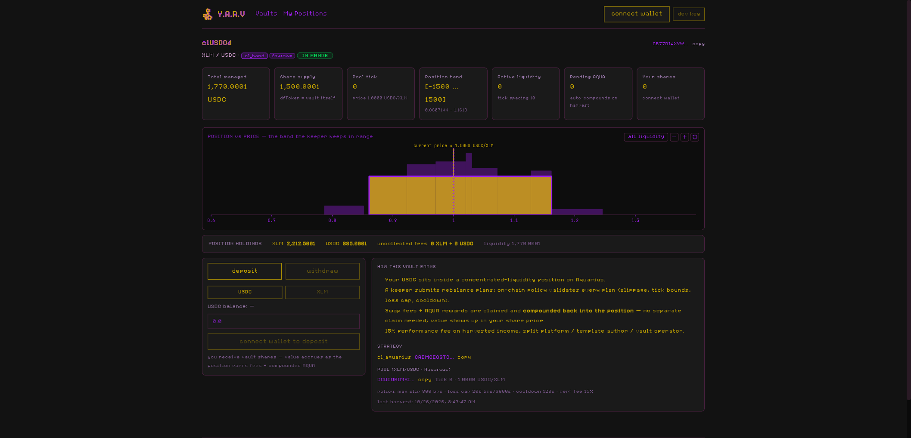
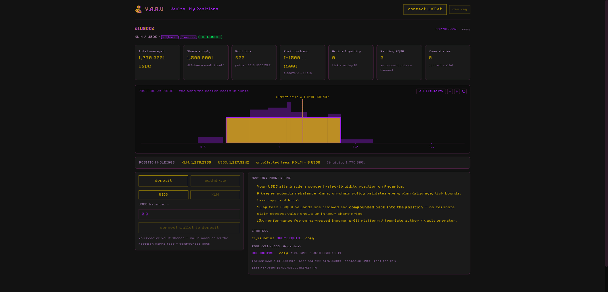
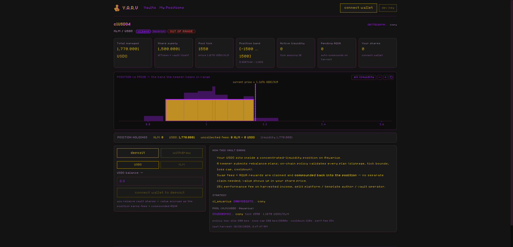
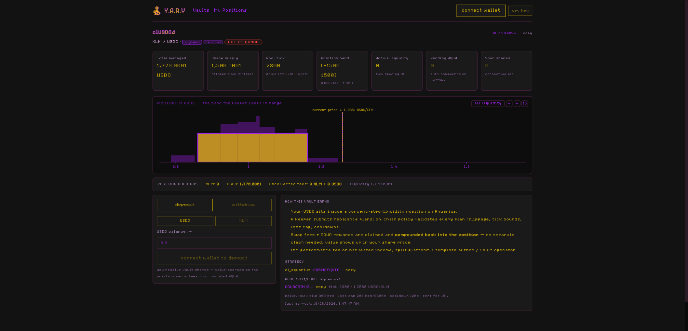
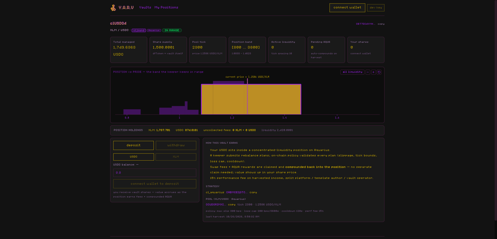
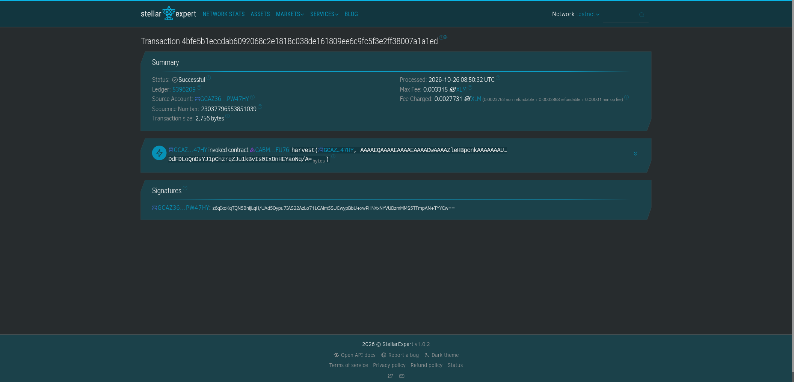
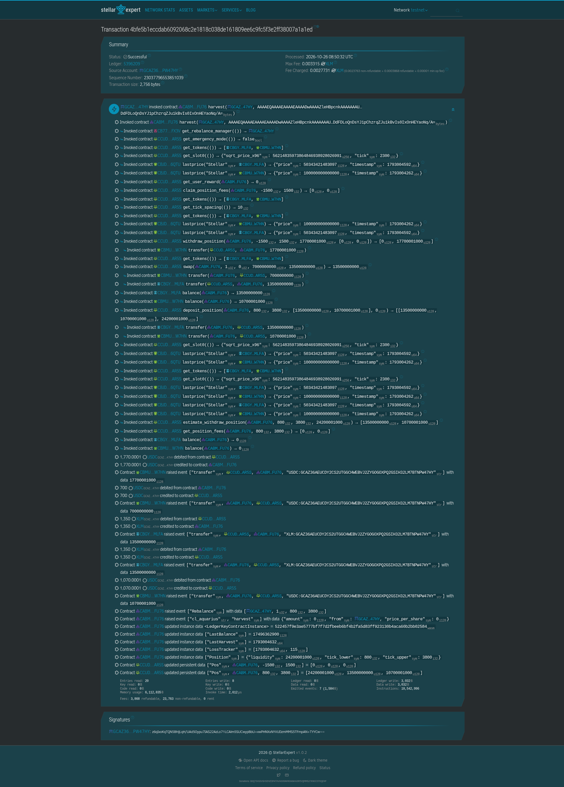

# Testnet deployment (smoke environment)

All addresses on Stellar testnet, deployed by `agent-1`
(`GCAZ36AEUCDY2CS2UTGGCHWEBVJ2ZYGOGOXPQ2GSIH32LM7BTNPW47HY`). Mocks stand in for
Aquarius/Reflector so the full platform wiring is exercised on a real network;
swap into a real testnet CL pool is a later step.

## Platform contracts

| Contract | Address | WASM hash |
|---|---|---|
| DeFindex factory (our instance) | `CDJ467CMUO6R6BLW4PTSMVEGVTUKVNNSIBFLHMK5Q6GK2WMYEDQTKRTR` | `446f6df3…` |
| strategy_registry | `CB4LGZVUF345GF5MLMWIZZR2E222SX6DAPQ2DOP3WEKQKBGJRO7I3RES` | `efbf1ff0…` |
| platform wrapper (v2 — emergency-ops fix) | `CDKAKRSZZB2NTOBSTT2KDEZSSLOZSQ4DKTGP6RGSJXFUUY6ZQ2HZLPGF` | `fcb1611c…` |
| ~~platform wrapper (v1)~~ superseded | `CB74CKXGUTTFP5P3ZEOX3VDR376YJKNLFQ6RKPX6QTEITHNG62D5F6RV` | `8a83f606…` |
| null_router | `CDEYX7WBCCSYXOFBMBOCB2WTLLROPQAWS5YQKUTYSDNBPD23EGASH5LQ` | `c0a49523…` |
| patched vault template | — | `c749c49c…` (installed, deployed per-vault by factory) |
| cl_aquarius template | — | `522457f9…` (installed + registered; `ea0f490b…` superseded) |

> **Next strategy build pending deploy**: source changes since `522457f9`
> (reward-feed failure isolation, `LastBalance` seeding on deposit/
> withdraw, new `rescue` export) build `57720813c68dc4b3…`. A v5 vault
> deployment is needed to ship them — template must be installed +
> registered, then a fresh `platform.create_vault` binds it.

> **Strategy redeployed under SDK 29.0.1** (2026-10-26): template
> `522457f9…2584` installed + registered in the registry alongside
> `ea0f490b…`; v4 vault below runs it. The platform contracts
> (factory/registry/platform/null_router) keep their SDK-22 binaries —
> only formatting changed in source, and cross-contract calls don't care
> about the callee's SDK version.
>
> **Platform v2 (2026-10-26)**: the v1 platform's `pause_strategy` /
> `unpause_strategy` / `rescue_vault` calls to the vault were missing the
> `caller` arg (vault ABI is `(strategy, caller)`) and the required
> invoker-auth declaration — they failed on testnet with
> `MismatchingParameterLen` and would have failed auth even with the
> right arity. Fixed in source (`call_emergency` helper), redeployed as
> `CDKAKRSZ…`; `registry.set_platform` re-pointed (`8aec32db…`) and the
> v4 vault's EmergencyManager updated via `set_emergency_manager`
> (`e5040e5d…`). Verified live: pause `7eb70987…`, unpause `586ab9a9…`.
> The v3 vault still points at the broken v1 platform — superseded anyway.
>
> **Shared-mock caveat**: the corrected reference-price convention means
> the mock pool's spot must be seeded `√(p0/p1)·2⁹⁶` = √0.4·2⁹⁶ —
> `set_spot` tx `8470de25…`. The v3 vault's strategy (old inverted
> convention) is incompatible with this spot and can no longer run
> oracle-gated ops on the shared mock.

Factory init: admin = agent-1, defindex_receiver = agent-1, defindex_fee = 0.

## Current vault (v4, created via `platform.create_vault`)

| Role | Address |
|---|---|
| Vault (clUSDC4) | `CB77DI4XYWTQTHS5FJWXFFDG5JQJFARP5KKEDM6GGAJ357XC5ZLBFX3V` |
| Bound cl_aquarius instance | `CABMCEQGTCR7CVEUCQFHP3MFNMLWYH3WUTERVEAKPEHYNOP6U65GFU76` |
| Strategy template | `522457f9e3ae5777bf7f7d2fbeeb6bf4b2fa5d83ff923130b4aca60b2bb02584` (SDK 29.0.1) |
| EmergencyManager | platform contract v2 (`CDKAKRSZ…`) — re-pointed via `set_emergency_manager` |
| Manager / FeeReceiver / RebalanceManager | agent-1 (operator role) |
| vault_fee | 0 (pinned) · upgradable=false · router=null_router |

Policy: identical to v3 (perf_fee 1500bps, platform_split 5000bps,
oracle_band 500bps, max_oracle_age 600s, max_slippage 300bps,
max_loss 200bps/3600s window, cooldown 120s, range 100–2000bps half-width,
tick_cap 1000bps, reward floor 0.1 AQUA, reward max age 1d) — decoded
verbatim from the v3 `create_vault` envelope `c0cb28b4…`.

### v4 verified flows (SDK-29 binary)

- `platform.create_vault` → vault+strategy, roles pinned — `6452402f…`
- `vault.deposit` 10e9 USDC → 9999999000 shares — `334135fa…`
- `vault.rebalance` Invest 8e9 → strategy pull — `9558f77a…`
- `harvest` SwapPlan → position deployed ticks **[-1500,1500]** — `f6260f03…`
- `vault.withdraw` all shares → unwind through the open position →
  9999999000 delivered — `2107cd79…`

### Rebalance demo arc (2026-10-26) — drift → OOR → keeper moves band

The withdraw-all above left the position as dust (liq 1000), so the vault was
re-funded for the demo. Prices are moved via mock `set_spot` + matching
`set_price` (XLM) so spot stays inside the 500 bps oracle band; tick 0 ≡
0.40 USDC/XLM. Screenshots: `video/shots/rebal_05..09_*.png`.

- refund: `vault.deposit` 15e9 USDC → 15e9 shares — `87b83e52…`
- `vault.rebalance` Invest 15e9 → strategy pull — `d248872a…`
- `harvest` SwapPlan ref_tick 0 → re-deployed **[-1500,1500]** — `9e92b3b2…`
- first drift+rebalance cycle (screenshots discarded — empty-vault arc):
  ladder 600/1550/2300, harvest → **[800,3800]** with a keeper swap step
  (7e9 USDC → 13.5e9 XLM, oracle-validated out_min) — `40e41641…`
- second drift ladder (the photographed arc):
  tick +3100 = 0.5454 `dfa3edcd…`/`1bb7aa5e…` → tick +3900 = 0.5908
  `2918ddf6…`/`664097b0…` → tick +4500 = 0.6273 `9981908c…`/`c4dd3bf4…`
  (position slid OUT OF RANGE past +3800; all charted bands OOR at +4500)
- keeper `harvest` SwapPlan ref_tick 4500 → unwind + redeploy
  **[3000,6000]**, position back in range — `210d9091…`

`check_loss_budget` note: the harvest post-check compares the new
oracle-valued balance against `LastBalance` — a price **rise** on an
XLM-heavy position counts as gain (always passes), a drop would count as
loss (max 200 bps/3600 s). Selling the appreciated leg inside the same
plan locks the gain in numéraire — that's what `40e41641…` did.

### Final photographed arc — position among peers, animated holdings

Re-shot so the vault band sits *among* the fixture positions and the
POSITION HOLDINGS row animates (the UI now derives the CL token mix from
live slot0 + band ticks — the mock's stored deposits never change).
Keeper = `GCAZ36…PW47HY` (the vault's RebalanceManager); every drift
step is a mock `set_spot` paired with a matching `set_price` so spot
stays inside the 500 bps oracle band.

Starting state: position `[3000,6000]` holding 13.5e9 XLM + 8e9 USDC
(~16.5e9 USDC marked). Spot first drifted to 6100 / XLM 0.7362:
[`a8ec4b28`](https://stellar.expert/explorer/testnet/tx/a8ec4b2887e073764149f9237f89c9a570fb3f38cfe6ab5fe8679057c2435f3d)
+
[`5a284209`](https://stellar.expert/explorer/testnet/tx/5a284209ad134ce9084cda6eb068fe4085c04cf6cf06944c8e370181584e284d).

**Phase 0 — reset so the band rejoins the other LPs.** Reverting price
while holding XLM would mark the position down ~18% → far over the
200 bps/3600 s loss budget, so the XLM leg is sold first at the high
oracle mark:

1. Reseed stale oracle prices (600 s TTL) — USDC:
   [`5216c1f5`](https://stellar.expert/explorer/testnet/tx/5216c1f5cafc48356f4e379783e74ee91d5c3898b3214012aae2f28cfcff3bc4),
   XLM:
   [`64b72693`](https://stellar.expert/explorer/testnet/tx/64b72693159b93f901aa156eaf68e70c48954b2fd1369c5538edde532f32491f)
2. Keeper `harvest` — swap step 13.5e9 XLM → 9.7e9 USDC, redeploy
   `[4600,7600]` all-stable:
   [`9a82ea12`](https://stellar.expert/explorer/testnet/tx/9a82ea1238fb1b618f0fdba43ffeec87ca0ec8e90bea156f4785b8ccc914389f)
3. Revert price to baseline — `set_spot` → tick 0:
   [`28d0b8dc`](https://stellar.expert/explorer/testnet/tx/28d0b8dc52c892b4dab7570798469256258a75619af562f1d64005c212b5cb78),
   `set_price` → 0.40:
   [`05b86936`](https://stellar.expert/explorer/testnet/tx/05b869368b8ed2843c69d9f92222eddad3b5eb9c8915708919132f09d5218c82)
4. Keeper `harvest` — redeploy `[-1500,1500]` around tick 0 (all-USDC,
   ~0% NAV change → passes loss budget):
   [`f8e640c1`](https://stellar.expert/explorer/testnet/tx/f8e640c17100f39b4f698f9618e0836c1bb194a6de77fbafd60271e0a3cfe008)

**Phase 1 — baseline.** Band `[-1500,1500]` interleaved with the
fixture positions, IN RANGE, holdings 2,212 XLM / 885 USDC:

**Phase 2 — gradual drift (each step = `set_spot` + `set_price`):**

5. tick 600 / XLM 0.4247:
   [`9984fcb7`](https://stellar.expert/explorer/testnet/tx/9984fcb710b32b234b8610382e8f3ac5d6ca8f4a4c2a37bfafa2480aa6830fae)
   +
   [`f6b68aa6`](https://stellar.expert/explorer/testnet/tx/f6b68aa660f74292a4fafe7f5ada9ace97e56c484e92fcb051566e8b0e6ca14e)
   — still in range, holdings drift 1,276 / 1,228:

   
6. tick 1550 / XLM 0.4671:
   [`794b8df5`](https://stellar.expert/explorer/testnet/tx/794b8df525094ec581e6f79c00b2a7798568fde802cd36ba6d6193c43acf179b)
   +
   [`72c00253`](https://stellar.expert/explorer/testnet/tx/72c00253fca3b9966f91df7b36791ee777e15bbee162d9b8388a91ea606889b1)
   — past the +1500 edge → OUT OF RANGE, holdings 0 XLM / 1,770 USDC
   (fully flipped):

   
7. tick 2300 / XLM 0.5034:
   [`a5c0f075`](https://stellar.expert/explorer/testnet/tx/a5c0f075a14c7cae6b0a7c0f50ffee8e0de8b8066ce5ae1c5c92b891e23c5e9a)
   +
   [`3e4bae98`](https://stellar.expert/explorer/testnet/tx/3e4bae9860ba5d4f1f159782042244feb3d9a98897254f455921f986680a8cf5)
   — every charted band out of range:

   

**Phase 3 — keeper rebalance.** `harvest` with SwapPlan
`ref_tick=2300, new_range=[800,3800]` plus a swap leg (7e9 USDC →
13.5e9 XLM at oracle-validated `out_min`):

8. unwind → swap → redeploy → `PPos` storage write
   `{tick_lower: 800, tick_upper: 3800}` —
   [`4bfe5b1e`](https://stellar.expert/explorer/testnet/tx/4bfe5b1eccdab6092068c2e1818c038de161809ee6c9fc5f3e2ff38007a1a1ed)
   → back IN RANGE, holdings 1,738 XLM / 875 USDC:

   

   On-chain evidence of the same tx — the keeper call, nested
   unwind/swap/redeploy trace, `Rebalance` event, and the
   `PPos {800, 3800}` storage write:

   
   

### Previous vault (v3 — SUPERSEDED, broken on shared mock)

| Role | Address |
|---|---|
| Vault (clUSDC3) | `CBOOPM4WFKSCXRDYGT5THN3JRKUABUW2VGKURAVDJGCF2GJ2TXU45I6G` |
| Bound cl_aquarius instance | `CBBG2JYTVJPJO3ZKZZID76GX5VNAMTD4NXNHYHCFI4VBTUUIGRLPD6HE` |

## Test fixtures (mocks — NOT real Aquarius/Reflector)

| Fixture | Address | Notes |
|---|---|---|
| Mock XLM/USDC CL pool | `CCUDORIMXIIJYOYYE5NEFBZ25JSJXNMQDPELGQRRHJY4IYNKBWV7AR5S` | test_mocks WASM `4dc6f5ca…`, spot √2.5·2⁹⁶ |
| Mock Reflector oracle | `CBJDZPVX6NI5FWFYV7VILKBKBP7V77II47ATS77TBSXWIKQYWNA56QTU` | prices 1e14-scale: USDC 1.0, XLM 0.4, AQUA 0.2 |
| Mock AQUA/XLM reward pool | `CB5NI7ZGBCSSPUF5635AHJRAZGCMK2YQI7MNT2GBGGJU4XXHP77A6SJN` | |
| USDC SAC | `CBMUABTPC5WH5IRYEQVYTSJ6DSN5SQUK6ROHEXPNDU36V2HHDMRAW7HN` | issuer agent-1 (mintable) |
| XLM SAC | `CBGYSLZB6NQEWQSDCSYGRPWQQHN7DFYNGRO3CC4KVCTIQWMHLJIFMLFA` | |
| AQUA SAC | `CAI4CUGFODGRBM65NCJIL3A2VTTR65AETUGVPU5WTF6XVISQ2MJ5C25Q` | |
| Batch router | `CBS4PBYTM5O26PFSKYGKN4G6ZFRYWKNJKKQ6CL4JFGFNIXHM637CVXZW` | reused internal batch-router WASM `a0d74427…` — wraps N invokeContract calls into one `exec(caller, calls)` host-function op so single-op wallets (Freighter) can sign zap bundles |

## Verified flows (tx hashes on testnet)

v1 vault (`CCOAAMXR…`/`CCYKUAVO…`, template 21e4cbfd — stale SwapPlan shape):
- `platform.create_vault` → deploy strategy + create vault + bind — `49f782e4…`
- `vault.deposit` 10e9 USDC → 9999999000 shares (1000 dead-share lock) — `f805517d…`
- `vault.rebalance` Invest 8e9 → strategy pull — `a0b74be7…`
- `vault.withdraw` all shares → P2 unwind path delivers 9999999000 — `efcc60b9…`

v3 vault (`CBOOPM4W…`/`CBBG2JYT…`, template ea0f490b — auth fix):
- `platform.create_vault` — `c0cb28b4…`
- deposit → invest → **harvest with live position deploy** (SwapPlan XDR, ticks
  [-100,100], `authorize_as_current_contract` covering pool token pulls) — `0ce3c9a8…`
- `vault.withdraw` all shares through the open position → 9999999000 delivered — `d3a1e313…`
- 2026-10-26: `harvest` → live position deployed at **ticks [-1500, +1500]**
  (±16% band, half=1500 ≤ range_max 2000) — `21e6a5c0…`; deposit of
  82.45 XLM + 7 USDC. CLI arg notes: `harvest`'s `data` (Option<Bytes>) takes
  JSON `{"bytes":"<ScVal hex>"}`; SwapPlan struct-map keys must be XDR-sorted
  (`expiry, new_range, ref_tick, steps`).
- Demo liquidity for the pool chart (mock has no position enumeration —
  frontend reads `KNOWN_POOL_POSITIONS` in `web_frontend/src/config.js`):
  agent-1 `deposit_position` bands [-800,-300] 40 XLM `ad3bd6bd…`,
  [200,700] 25 USDC `e02bac26…`, [-2400,-1600] 30 XLM `abefe8f5…`,
  [1200,2200] 15 USDC `86c17402…`, [-300,300] 20 XLM+8 USDC `0e716784…`.
- **reward conversion** — `set_user_reward` 2e9 AQUA → harvest claimed + swapped via
  reward pool → 970e6 XLM out (oracle min-out 0.97×fair) → `FeeAccrued` event shows
  15% skim split 72.75e6 platform / 72.75e6 operator — `6bd44589…`
- 2026-10-26: **web UI zap flows through the batch router** (one host-function op
  each, Freighter-signed): withdraw 15 shares → 50% USDC / 50%→XLM split —
  `cd4cd8ba…`; 0.5 XLM → swap → deposit zap — `560b7d81…`; withdraw 2 shares via
  in-page dev-key signer — `5a398220…`. All `successful`, `operation_count=1`.

## Notes for real-pool integration

- Strategy init args order: `[pool, oracle, registry, treasury, policy, reward_token, reward_pool]`,
  packed as constructor args `[asset, vec(init_args)]`; optional `init_args[7]`
  = `Vec<OracleRoute>` for per-asset feeds (required on mainnet — XLM/USDC use
  the external Reflector feed via `Other` symbols, AQUA the DEX feed via `Stellar`).
- Policy contracttype map keys must be **sorted** in XDR (`cooldown_secs` first … `tick_cap_bps` last).
- `deploy_strategy` checks `init_args[4]` = Policy against registry ceilings + venue allowlist.
- **Nested-pull auth**: pools pull via `token.transfer(strategy→pool)`, one level
  deeper than invoker auth covers. The strategy must `authorize_as_current_contract`
  before `deposit_position`/`swap` (added in `authorize_pull`) — same pattern the
  DeFindex vault uses for strategy deposits. `mock_all_auths` hides this locally;
  only real-network calls surface it.
- Oracle prices age past `max_oracle_age` quickly on testnet — re-seed `set_price`
  before harvest/withdraw runs.
- The mock pool spot convention is `√(units_token1/token0)·2⁹⁶` — for
  t0=XLM ($0.4) / t1=USDC ($1.0): `√0.4·2⁹⁶ = 50108289675009587501223378944`.
  `set_spot` takes the full sqrt_price_x96 numerator (2⁹⁶ already folded in).
